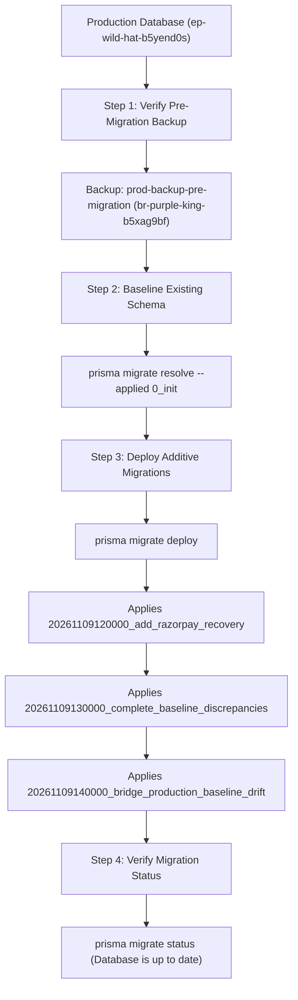

# PREHERITAGE — Production & Development Rollout Runbook

This runbook outlines the step-by-step, zero-downtime deployment sequence for the PREHERITAGE payment recovery release (`codex/preheritage-ecommerce-fixes`).

---

## 1. Verified Release Commit Stack

The following three local commits encapsulate the complete verified release:

| Commit Hash | Commit Message | Key Changes |
| :--- | :--- | :--- |
| [`bbb3308`](file:///c:/Users/YASH/Downloads/PREHERITAGE-fixed-audit/PREHERITAGE-With-Official-Logo/src/lib/razorpay-checkout-recovery.ts#L209) | `fix: increase Razorpay recovery transaction timeout` | Increases Prisma transaction timeout (`maxWait: 15s, timeout: 30s`) and skips unnecessary coupon advisory locks. |
| [`66e0e8f`](file:///c:/Users/YASH/Downloads/PREHERITAGE-fixed-audit/PREHERITAGE-With-Official-Logo/prisma/migrations/20261109120000_add_razorpay_recovery/migration.sql) | `feat(payments): add Razorpay webhook handler, recovery schema, and migrations` | Adds `/api/razorpay/webhook`, `razorpay-webhook-handler.ts`, `0_init` baseline, `20261109120000_add_razorpay_recovery`, `directUrl` in `schema.prisma`, and recovery integration tests. |
| [`0dbc24c`](file:///c:/Users/YASH/Downloads/PREHERITAGE-fixed-audit/PREHERITAGE-With-Official-Logo/prisma/migrations/20261109130000_complete_baseline_discrepancies/migration.sql) | `feat(payments): finalize Razorpay recovery and migration release` | Adds `20261109130000_complete_baseline_discrepancies` (idempotent `heritage_philosophy`, category metadata, duplicate-checked unique payment indexes) and updates integration test concurrency assertions. |

---

## 2. Environment Variables Checklist

Ensure the following environment variables are present in the target environment (Vercel Project Settings and `.env.production`):

| Variable Name | Purpose | Notes |
| :--- | :--- | :--- |
| `DATABASE_URL` | Pooled connection string | Points to Neon PgBouncer pooler (`?sslmode=require&pgbouncer=true`). |
| `DIRECT_URL` | Unpooled connection string | Direct Neon endpoint without PgBouncer; required for Prisma migrations and advisory locks. |
| `RAZORPAY_KEY_ID` | Razorpay Gateway Key ID | Must match the environment mode (TEST for development, LIVE for production). |
| `RAZORPAY_KEY_SECRET` | Razorpay Gateway Secret | Server-side signature validation and API calls. |
| `RAZORPAY_WEBHOOK_SECRET` | Webhook signature HMAC secret | Configured in Razorpay Webhooks dashboard. |
| `NEXT_PUBLIC_RAZORPAY_KEY_ID` | Storefront Razorpay Key ID | Public key exposed to the client checkout modal. |
| `NEXTAUTH_SECRET` | NextAuth session token hashing | 32+ character high-entropy secret. |
| `NEXTAUTH_URL` | Canonical app URL | e.g. `https://preheritage.com` or Vercel preview domain. |

---

## 3. Database Migration Sequence

Because the Neon development (`ep-dark-pine-b565nrk4`) and production (`ep-wild-hat-b5yend0s`) databases already contain historical tables and data, migrations must be applied using the established baselining procedure.



### Approved Migration Sequence & Checksums

| Migration Name | Purpose | Verified SHA-256 Checksum |
| :--- | :--- | :--- |
| `0_init` | Baseline initial schema | `d64d10ef39e1200f50f11873ccb0a904d6c6cd4625a0626dc0a8bc162a4594eb` |
| `20261109120000_add_razorpay_recovery` | Recovery tables & tracking | `ee828c7445829d356e2a8c86e9792f0a7746f0414616b18837b124448311ff9a` |
| `20261109130000_complete_baseline_discrepancies` | Philosophy, metadata & payment indexes | `7b12f60c7a84de411b62a176a5c608ab2b39756c706493d3c9b7ec3f8ba17b9d` |
| `20261109140000_bridge_production_baseline_drift` | Orders COD idempotency columns & unique index | `d86f45f7355f0da5f33828c2b839570053aa91f237871a3adcaa676f148c22e9` |

### Execution Commands (Run Against Direct Unpooled Endpoint)

```bash
# 1. Mark the baseline migration as already applied (DO NOT run raw SQL for 0_init)
npx prisma migrate resolve --applied 0_init

# 2. Deploy the three pending additive migrations
npx prisma migrate deploy

# 3. Verify status
npx prisma migrate status
```

---

## 4. Razorpay Dashboard Webhook Configuration

1. Log in to the [Razorpay Dashboard](https://dashboard.razorpay.com/).
2. Navigate to **Settings** > **Webhooks** > **Add New Webhook**.
3. **Webhook URL**: `https://<your-domain>/api/razorpay/webhook`
4. **Secret**: Enter your high-entropy secret (matching `RAZORPAY_WEBHOOK_SECRET`).
5. **Alert Email**: Enter engineering alert email address.
6. **Active Events**:
   - `payment.captured` (Primary event triggering order recovery)
   - `payment.failed` (Updates checkout status to failed)
   - `order.paid` (Auxiliary order completion notification)
7. Save the webhook and test endpoint ping.

---

## 5. Rollout Procedure: Development First, Then Production

### Phase A: Development Deployment
1. Connect unpooled `DIRECT_URL` to development database (`ep-dark-pine-b565nrk4`).
2. Run `npx prisma migrate resolve --applied 0_init`.
3. Run `npx prisma migrate deploy`.
4. Deploy branch `codex/preheritage-ecommerce-fixes` to the Vercel Development/Preview environment.
5. Execute end-to-end checkout test with Razorpay Test Mode credentials:
   - Success payment -> Order created, checkout marked `FINALIZED`.
   - Simulated network drop / webhook delivery -> Recovery service successfully finalizes order.
   - Concurrency / duplicate payment check -> Duplicate protection rejects second payment.

### Phase B: Production Deployment
1. Verify the Neon production backup branch `prod-backup-pre-migration` (`br-purple-king-b5xag9bf`, LSN: `0/25F8568`).
2. Connect unpooled `DIRECT_URL` to production database (`ep-wild-hat-b5yend0s`).
3. Run `npx prisma migrate resolve --applied 0_init`.
4. Run `npx prisma migrate deploy` (applies `20261109120000`, `20261109130000`, and `20261109140000`).
5. Merge `codex/preheritage-ecommerce-fixes` into `main` and trigger production Vercel deployment.
6. Verify live storefront health check (`/`, `/shop`, `/checkout`).
7. Perform single low-value live test transaction to verify payment capture and receipt generation.

---

## 6. Rollback Strategy & Triggers

### Rollback Triggers
- Any fatal schema migration error.
- Failure of `/api/razorpay/webhook` to verify valid signatures.
- Repeated checkout finalization failures or timeouts (> 30s).

### Rollback Steps
1. **Application Rollback**: Instant redeployment of previous production deployment via Vercel Dashboard (< 60 seconds).
2. **Database Schema**: Because migrations are strictly additive (adding new tables and non-null columns with defaults), the previous application version is 100% forward-compatible with the new schema. No table drops are necessary.
3. **Emergency Webhook Deactivation**: Toggle off the webhook in Razorpay Dashboard if bad payloads cause unhandled exceptions.
